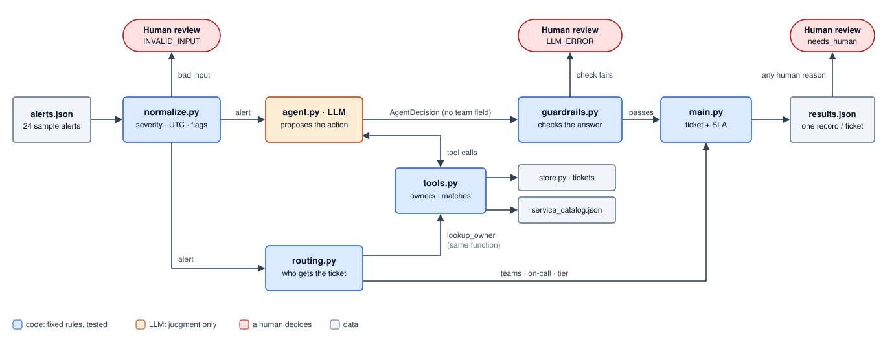

# Architecture

`main.py` runs these steps for each alert, one at a time, in file order.

**The rule:** the model proposes, code enforces. The model never outputs a team, every ticket ID it returns must come from a tool call in the same run, and its action must fit what the tool found.

## What each step decides

**routing.py** (code, before the agent runs, so the model has no say in who gets the ticket)

| Service in the catalog | Result |
|---|---|
| One owning team | Routed to that team automatically |
| More than one team | All teams notified, none picked, `CO_OWNED` |
| Not in the catalog | Security lead on-call, `NOT_IN_CATALOG` |

**agent.py** (LLM, judgment only)

| What `find_matching_tickets` returned | Action |
|---|---|
| Open ticket, exact match | `link` |
| Resolved ticket, exact match | `reopen` + `RECURRENCE` |
| Partial match | `link` + `AMBIGUOUS_DUPLICATE` |
| No match | `create` |
| Note says "already fixed" | Severity stays, `UNVERIFIED_MITIGATION` |

**guardrails.py** (code, checks the model's answer)

| Check | If it fails |
|---|---|
| Ticket ID was returned by a tool in this run | Rejected, `LLM_ERROR` |
| Action fits the match (no `create` on exact, `reopen` on open, `link` to resolved) | Rejected, `LLM_ERROR` |
| Model added the reason the match calls for | Code adds it |
| Recommended priority is lower than the severity | `PRIORITY_DOWNGRADE`, a human approves |

## Severity vs. tier

**Severity** (Sev-0 to Sev-3) is how bad the finding is. It comes from the scanner's score, normalized by `normalize.py`. The model may recommend a change, but can't make it.

**Tier** (P0 to P3) is how critical the service is. It comes from `criticality_tier` in the service catalog and nothing changes it.

The **SLA** comes from both. A service missing from the catalog has no tier and gets the strictest column (P0/P1).
