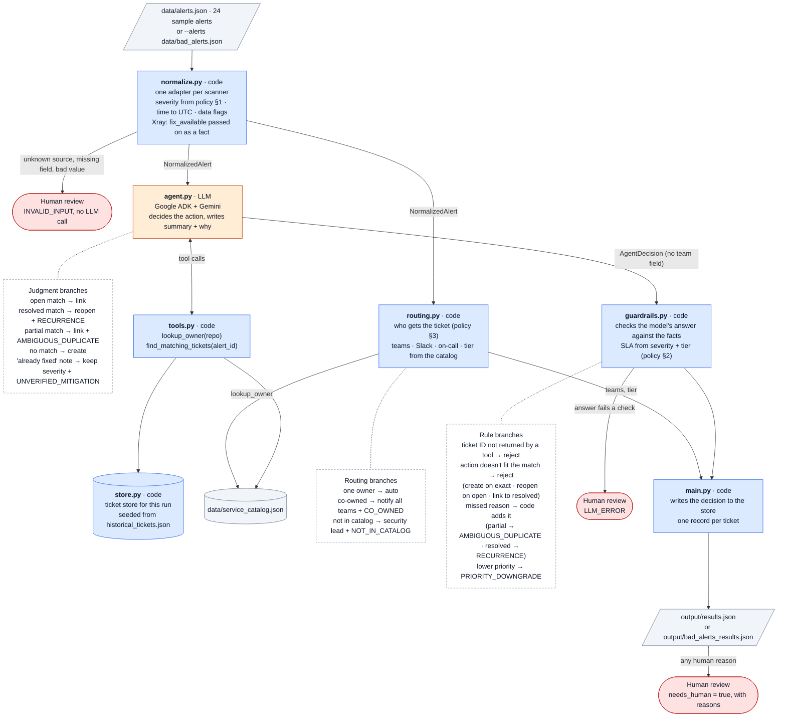

# Architecture

`main.py` runs the steps below for one alert at a time, in file order.
Blue = code (fixed rules, tested). Orange = LLM (judgment only). Red = a human decides.

**The rule:** the model proposes, code enforces. The model never outputs a team, every ticket ID it returns must have come from a tool call in the same run, and its action must fit what the tool found.

**Routing runs without the model.** `routing.py` reads the owner and tier from the service catalog before the agent runs, so the model has no say in who gets the ticket.

**Severity vs. tier.** Severity (Sev-0 to Sev-3) is how bad the finding is. It comes from the scanner's score, normalized by `normalize.py`, and the model may recommend changing it. Tier (P0 to P3) is how critical the service is. It comes from `criticality_tier` in the service catalog and nothing in the pipeline changes it. The SLA is set by both. A service missing from the catalog has no tier and gets the strictest SLA column (P0/P1).
